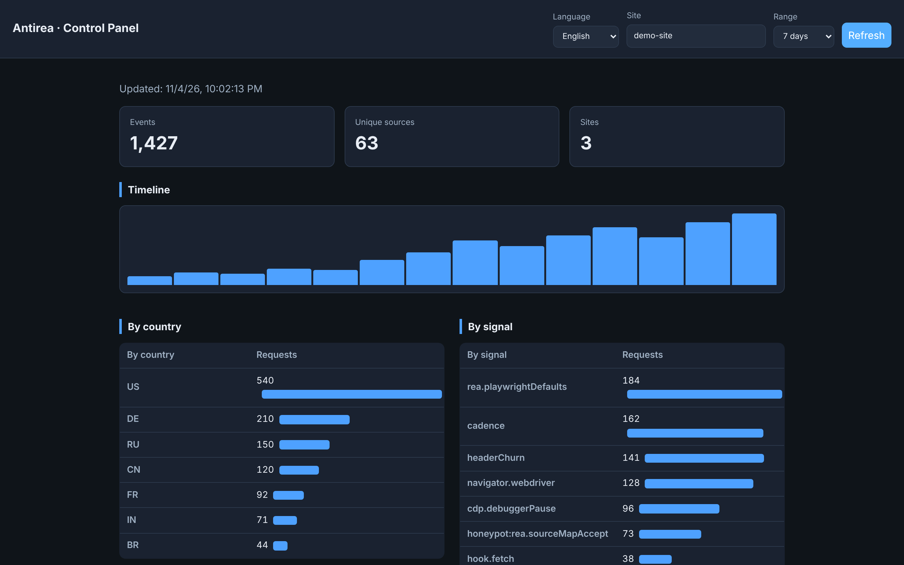
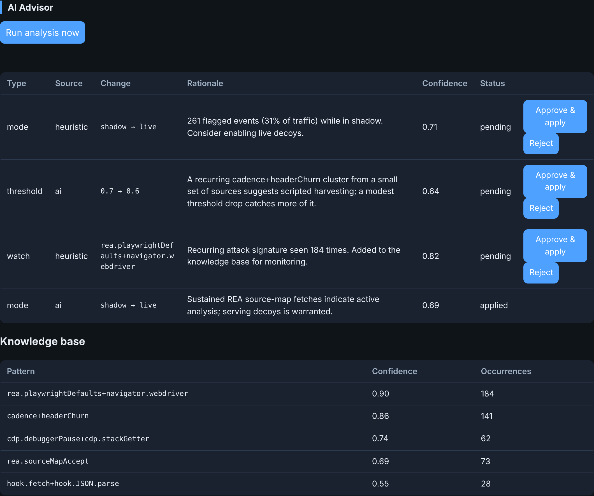
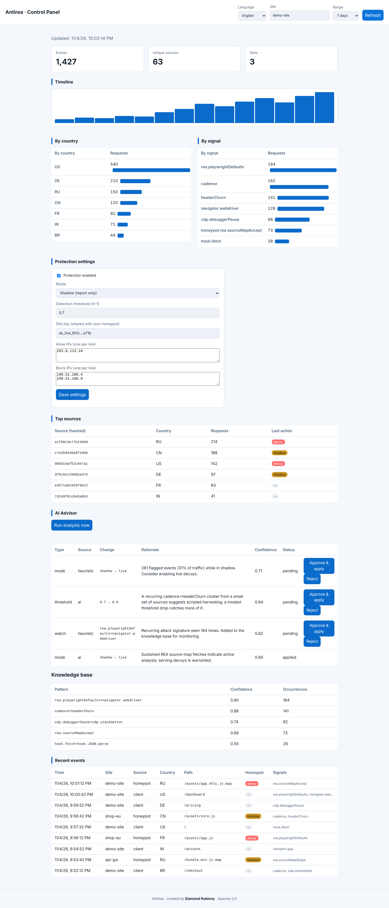

# Antirea

[](https://github.com/diamondrubinny/Antirea/actions/workflows/ci.yml)
[](./LICENSE)


**Drop-in protection against reverse-engineering and cloning, with a control panel that shows who tried, from where, and how often.**

Any website, SaaS, or app can add Antirea to deter analysis tools (including CDP/DevTools-based ones such as REA), serve decoys to detected harvesters, and — for the logic that actually matters — run it on the server where it can never be reverse-engineered.

> 🌍 Control panel available in English, עברית, Español, Français, Deutsch, العربية, Português, Русский, 中文.

## Demo

<p align="center">
  
</p>

<p align="center"><em>Live stats → honeypot activity → REA fingerprints → AI advisor → instant language switch (English / עברית / العربية, RTL). <a href="docs/media/demo.webm">Full-quality clip</a>.</em></p>

## Screenshots

The self-hosted control panel — live stats, behavioural detection, honeypot
activity, top sources, and the adaptive AI advisor (dark & light themes, 20
languages, RTL):

<p align="center">
  
</p>

<p align="center">
  
</p>

<details>
<summary>Light theme — full page</summary>

<p align="center">
  
</p>

</details>

---

## ⚠️ Read this first — what is hermetic, and what is not

Shipping a security tool means being honest about its guarantees. Antirea has **two regimes**:

| What you protect | Can CDP/REA reverse-engineer it? | Antirea's answer |
|---|---|---|
| **Your proprietary logic / algorithm** | **No** — if it never reaches the browser, there is nothing to read | ✅ **`@antirea/secure-fn` — runs it on the server. Hermetic.** |
| **Code that must ship to the browser (UI)** | Yes, eventually — anything sent to a browser can be read | ⚠️ Detection + honeypot + behavioural engine. **Raises cost, not a wall.** |

**There is no client-side technique that makes delivered JavaScript impossible to reverse-engineer.** Anyone claiming otherwise is selling false security. Antirea's *hermetic* guarantee is server-side execution; everything client-side is defense-in-depth that deters, detects, and reports. Use both.

---

## Packages

| Package | Role |
|---|---|
| **`@antirea/secure-fn`** | **The hermetic core.** Runs proprietary functions on the server; client sends inputs, gets outputs. CDP never sees the algorithm. |
| `@antirea/honeypot` | Express/connect middleware. Behavioural detection (IP, cadence, timing, header instability) + serves decoys. Shadow mode by default. |
| `@antirea/guard` | Browser library. Detects DevTools/CDP/automation and reports telemetry. `<script>` or npm. |
| `@antirea/challenge` | **Proof-of-work gate** — makes high-volume scraping pay CPU (server issue/verify + browser solver). Plus honeypot **tarpit** and **JA3/TLS** signal. See [`docs/BOT-DEFENSE.md`](./docs/BOT-DEFENSE.md). |
| `@antirea/harden` | **Client-code hardening** — SRI/CSP/security headers, an obfuscation preset, encrypted-bundle delivery, and guard **domain lock** (flag rehosted clones). See [`docs/HARDENING.md`](./docs/HARDENING.md). |
| `@antirea/watermark` | **Traitor tracing** — per-viewer watermarking (identify a leaker), canary scanning (find leaks on GitHub), and attack-spike webhooks. See [`docs/WATERMARKING.md`](./docs/WATERMARKING.md). |
| `@antirea/adaptive` | **Learns from attacks** and proposes bounded defense changes. Heuristics always; AI optional (BYO key). Suggest-only by default. |
| `@antirea/collector` | Ingest API + GeoIP + SQLite + the **multi-language control panel** (stats, settings, AI advisor). |

---

## Quickstart

### 1. Run the collector + control panel

Requires **Node.js 22+** (24 LTS recommended).

```bash
npm install
npm run build            # builds every package; the collector imports adaptive + watermark
cd packages/collector && cp .env.example .env
node -e "console.log('IP_SALT='+require('crypto').randomBytes(32).toString('hex'))"
node -e "console.log('ADMIN_TOKEN='+require('crypto').randomBytes(32).toString('hex'))"
# paste both into .env, then:
npm start
```

Open `http://localhost:8080/`, enter your `ADMIN_TOKEN`, pick a language.

> Behind a reverse proxy, set `TRUST_PROXY` to the **number** of proxies in front
> of the collector (`true` = 1, maximum 10; any other value refuses to start). Only
> that hop of `X-Forwarded-For` is trusted, so clients cannot forge their IP to
> dodge rate limits. This holds only if the collector is reachable **solely
> through that proxy chain**: firewall direct access to the collector (and, with
> `TRUST_PROXY=2`, to the inner proxy, so traffic cannot skip the CDN), and make
> each trusted proxy *append* the client address to `X-Forwarded-For`.

### 2. Add the honeypot to your server (one middleware)

```ts
import express from "express";
import { honeypot } from "@antirea/honeypot";

const app = express();
app.use(honeypot({
  siteId: "my-site",
  protect: [/^\/assets\/.*\.js$/, /\.map$/],  // the files you want to protect
  mode: "shadow",                              // start here; switch to "live" after tuning
  reportUrl: "https://collector.example.com/api/events",
  allowlist: { verifyReverseDns: true },       // protects Googlebot/Bing → SEO safe
  // Optional: control mode/threshold/allow/block lists live from the panel:
  // config: { url: "https://collector.example.com/api/site-config", siteKey: "<the panel's Site key>" },
}));
app.use(express.static("public"));
```

### 3. Add the guard to your pages (one script tag)

```html
<script src="https://your-cdn/antirea-guard.iife.js"
        data-site-id="my-site"
        data-endpoint="https://collector.example.com/api/events"
        data-mode="silent"></script>
```

### 4. Protect the logic that matters — hermetically

```ts
// SERVER — the algorithm lives here forever; CDP/REA never sees it
import { createSecureFnRouter } from "@antirea/secure-fn";
app.use("/secure", createSecureFnRouter({
  secret: process.env.SECUREFN_SECRET,
  reportUrl: "https://collector.example.com/api/events",
  maxInvokesPerMin: 60,
  functions: { pricing: (args) => ({ result: args.x * 1337 + 17 }) },
}));
```
```ts
// BROWSER — zero proprietary logic, zero secret
import { createSecureClient } from "@antirea/secure-fn/client";
const api = createSecureClient({ endpoint: "/secure" });
const { result } = await api.invoke("pricing", { x: 2 });
```

Not on Express? `@antirea/secure-fn/web` exports a standard
`(Request) => Response` handler (Next.js App Router and other Node.js
frameworks). Adapters, guards and a guide to choosing what to move server-side:
[`docs/SECURE-FN.md`](./docs/SECURE-FN.md).

---

## Control panel

At `http://<collector>/` (behind your `ADMIN_TOKEN`):

- **Live stats** — events, unique sources, timeline, by country, by signal.
- **Top sources** — the most active (hashed) sources and their last action.
- **Protection settings (live)** — toggle protection, switch Shadow/Live, set the detection threshold, manage **Allow/Block IP lists**, and set the **Site key**. Changes are pulled by your honeypot within ~30s — no redeploy. (Requires wiring the honeypot `config` option in step 2.)
- **Languages** — 20 languages (en, he, es, fr, de, ar, pt, ru, zh, it, ja, ko, tr, hi, nl, pl, id, vi, fa, uk), switch instantly; RTL for Hebrew, Arabic and Persian.

The project website, [norea.rubinny.net](https://norea.rubinny.net), is in six languages (English, Hebrew, Spanish, French, German, Arabic) with RTL, a localized cookie banner and privacy page.

---

## Behavioural detection — resistant to header tampering

Attackers spoof the `User-Agent` and other headers. Antirea's engine (`@antirea/honeypot`) **does not trust client headers.** It scores server-observed facts:

- **Velocity** — requests per 10s from an IP.
- **Timing regularity** — scripts fire at suspiciously even intervals (low coefficient of variation).
- **Fast cadence** — sustained sub-human request spacing.
- **Harvesting shape** — many distinct asset paths with zero real page navigations.
- **Header instability** — one IP presenting several identities ⇒ forged/rotated headers → **raises** the score. *Tampering with the header works against the attacker, not for them.*
- **Header forgery** — a UA claiming modern Chromium but missing Client-Hints/Sec-Fetch is detected as a lie.

**Honest scope:** this is statistical deterrence. A slow, single-identity scraper can stay under thresholds. For logic that must stay secret, use `@antirea/secure-fn`.

---

## REA signature pack

Antirea ships fingerprints for the `morluto/rea` tool — **verified against REA
6.8.0's source and measured on real Node and Chromium** — each documented with
its evadability in [`docs/REA-SIGNATURES.md`](./docs/REA-SIGNATURES.md):

- **Server** — REA's source-map fetcher runs on Node's `fetch`: its `Accept`
  header contains the `application/source-map+json` media type, which no
  browser sends (`rea.sourceMapAccept`). Node's own defaults —
  `user-agent: node`, `accept-language: *` and a *partial* Sec-Fetch set — form
  one combined runtime fingerprint (`ua.runtimeFetch`,
  `forgery.partialSecFetch`, `acceptLanguage.wildcard`), capped below the decoy
  threshold: a plain Node script harvesting your bundles is **reported**, and is
  decoyed only when corroborated (e.g. it requests a `.map`, which is how a REA
  fork with a changed `Accept` is still caught).
- **Source-map canary** (`canary.sourceMap`) — REA fetches every source map a
  page declares; point a bundle at an unlinked map URL with
  `sourceMapCanaryComment()` — or let the Vite/Rollup plugin
  (`@antirea/honeypot/build`) add one to every chunk — and a hit means *some* source-map consumer read it
  (REA, a harvester — or a developer with DevTools open). Strong evidence of
  analysis, not proof of REA; not scored for allowlisted or disabled traffic.
- **Client** — REA's scripted-scenario patches: unique `rea-restore-*` /
  `rea-service-workers-*` markers (`rea.scenarioSwPolicy`, near-certain) and
  Playwright's service-worker block (`automation.swBlockPatch`); the default
  Playwright profile (`rea.playwrightDefaults`); and the `debugger` pause REA
  never suppresses (`cdp.debuggerPause`).

REA has no stealth code. It **can** read a protected bundle that was already
decrypted before it attached — see the honest
[what REA can and cannot defeat](./docs/REA-SIGNATURES.md#what-rea-can-and-cannot-defeat-honest)
table. These are deterrence + intelligence; the hermetic protection remains
`@antirea/secure-fn`.

## Client logic that must ship → WASM

For logic that can't move to the server (latency/offline), ship the sensitive
part as **WebAssembly**: a CDP/REA client dumps an opaque binary, not readable
JS. Load it through the same attestation gate so detected clients get a decoy:

```ts
import { instantiateProtectedWasm } from "@antirea/guard";
const logic = await instantiateProtectedWasm("logic", { endpoint: "/__p/" });
logic.priceQuote(2);
```

Working example in `examples/wasm-logic/` (AssemblyScript → `.wasm`, with a test
proving the formula is absent from the binary). Full guide: [`docs/WASM.md`](./docs/WASM.md).
Strong deterrence, not hermetic — WASM can still be disassembled.

## CDP / REA specifics

A tool attached via the Chrome DevTools Protocol reads source directly from the engine. For **client code** Antirea adds: a CDP probe in the guard (`debugger`-timing — REA's passive capture does not suppress pauses — plus `Error.stack`/`RegExp.toString` console traps) and **attestation-gated delivery** (`importProtected`) so protected modules are fetched out-of-band and replaced with decoys under CDP. These raise cost; `blackboxing` and a forged attestation header defeat them. For **logic**, `@antirea/secure-fn` is the real answer.

---

## Adaptive AI advisor (optional, `@antirea/adaptive`)

Learns from the attacks it sees and proposes defense changes. **Off by default; turn it on in the collector's `.env` (`AI_ENABLED=true` + an API key).**

- **Heuristics run always** (no key needed): they summarize recent events, build a **knowledge base** of recurring attack signatures (signal combos, with confidence that grows as a pattern recurs), and propose bounded tweaks.
- **AI advisor (BYO key, default Claude `claude-opus-5-5`)**: sends only an **aggregated, non-PII summary** (counts, country codes, signal names — never raw IPs or User-Agents) and returns analysis + proposals.
- **Control panel → AI Advisor tab**: run analysis, review proposals, **Approve & apply** or **Reject**.

**Safety design (important for a feedback-driven system):**
- **Suggest-only by default.** A human approves every change. `AI_AUTO_APPLY` is off by default and, even on, only applies *small threshold steps* — never mode switches, never IP blocks.
- **Model output is untrusted.** Every proposal is clamped to hard bounds (`threshold ∈ [0.4, 0.95]`, `mode ∈ {shadow, live}`) before storage, so a poisoned or prompt-injected model cannot push a defense outside the safe envelope.
- **Poisoning is possible in principle** — an attacker who feeds crafted traffic could try to nudge recommendations. Human-in-the-loop + bounds + no auto-hard-block are the mitigations. Review proposals; don't enable auto-apply unless you understand this.
- **No raw IPs leave the collector**, so the AI never proposes IP blocks (that stays a manual operator action from the Top-sources view).

## Security & privacy (GDPR / IL Privacy Law — draft, needs legal review)

- **No raw visitor IP is stored.** For every event the collector derives a country and stores `sha256(ip + secret salt)` only. (IP addresses an administrator types into the Allow/Block lists are configuration and are stored as entered.)
- Telemetry is minimal: event type, signal names, path (query stripped by default), UA, language, screen, timezone.
- Admin panel + APIs require a bearer token; the per-site config read requires a Site key.
- Automatic retention pruning (`RETENTION_DAYS`, default 90).
- Payload caps, rate limiting, strict validation, security headers, configurable CORS.
- You must provide a privacy policy and a lawful basis for processing. **Have a lawyer review it.**

---

## Limitations (please read before relying on it)

1. **Client code cannot be made unreadable.** Only `secure-fn` (server execution) is hermetic.
2. **Behavioural detection is statistical** — false positives are possible, so **Shadow mode is the default**; tune before going Live. Keep the bot allowlist current to protect SEO.
3. **CDP source reads bypass client defenses**; a determined operator with blackboxing evades the client layer.
4. In-process behavioural state and rate limits are **per-instance**; multi-instance deployments need a shared store (e.g. Redis).
5. **GeoLite2 (geoip-lite) licensing** for commercial use needs verification.

---

## Deploy

- **Docker:** `docker compose up --build` (see `docker-compose.yml`). The image runs
  on Node 24 as the unprivileged `node` user; data lives on the `/data` volume.
  **Upgrading an existing deployment?** Follow the one-time volume-ownership and
  database-path steps in the [CHANGELOG upgrade notes](./CHANGELOG.md#upgrade-notes).
- **Windows Server:** run the collector as a Windows Service — see
  [`packages/collector/windows/README.md`](./packages/collector/windows/README.md).
  (The `honeypot`/`secure-fn` packages need no installer; they `npm install`
  into your app. The Microsoft Store is not used — a server belongs in a
  service, not a sandboxed Store app.)

## Development & tests

```bash
npm install
npm run build:guard
# verified test suites:
node packages/secure-fn/test/e2e.mjs      # 13 checks: session, server-side result, replay, forgery, rate limit, proxy IP, body rules
node packages/honeypot/test/behavior.mjs  # 4 checks: cadence, header churn, harvesting, human-like
npm run test:integration                  # e2e proof vs. the real server (see below)
```

**End-to-end proof.** `test/integration.mjs` boots the real example server
(honeypot in live mode + secure-fn) and asserts the whole chain works: an
analysis-shaped request (headless UA, or REA's source-map `Accept`) receives an
inert **decoy**; a real browser receives the **real** asset; `secure-fn` returns
the computed **output** while the proprietary constant **never appears** in
anything served to clients.

See `examples/protected-site/` for a focused demo, and
[`examples/full-stack/`](./examples/full-stack/) for one app that wires **all
seven packages** together with an 11-check end-to-end test (`node
examples/full-stack/test.mjs`).

## Contributing translations

Add a language by adding one entry (same keys) to `packages/collector/public/i18n.js`. English is authoritative; other translations are community-provided and not professionally reviewed — corrections welcome.

Hebrew docs: [`README.he.md`](./README.he.md). Design notes: [`PLAN.md`](./PLAN.md).

## Author & credit

Created and maintained by **Diamond Rubinny**.

Every source file carries a credit header, and the minified guard bundle keeps
a credit banner. **This credit must be preserved** in any copy or derivative
work (Apache-2.0 §4 + [`NOTICE`](./NOTICE)). Don't strip the `Diamond Rubinny`
notices.

## License

Licensed under the **Apache License 2.0** — see [`LICENSE`](./LICENSE) and
[`NOTICE`](./NOTICE). Using, modifying, or redistributing the code requires
retaining its copyright and attribution notices.

---

<sub>**Website:** <https://norea.rubinny.net> · **Keywords:** NoREA, anti-REA, block REA, stop REA,
REA reverse engineering, anti reverse engineering, reverse-engineering protection, source code
protection, code cloning protection, CDP / DevTools detection, honeypot, anti-bot, anti-scraping,
anti-tampering, bot detection, WASM code protection, protect JavaScript, threat intelligence,
TypeScript, Node.js.</sub>
